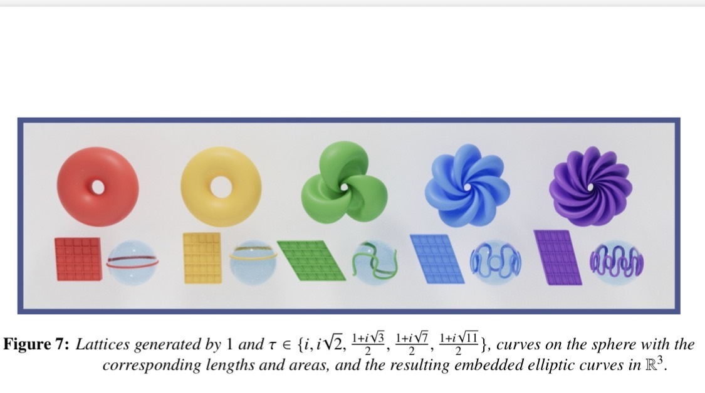
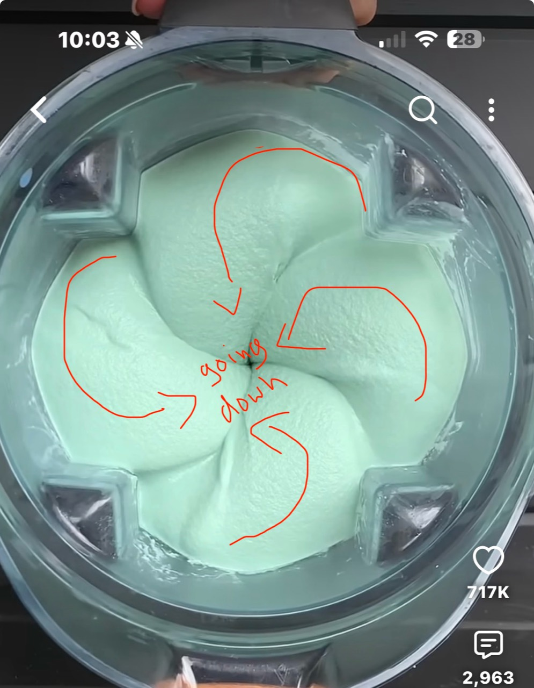

# From observed lobes to a geometric construction

Status: motivating observations and open questions, not a demonstrated equivalence.

## How the question began

The learner first became curious about blender flow: repeated lobes apparently crawl up the walls and descend toward the center. Later, independently encountering the mathematical art figure below, they recognized what looked like the same organization. An AI-generated interactive winding diagram then appeared to reproduce the up/down pattern, even though that AI had been skeptical of the elliptic-curve connection.

That diagram's code, equations, and actual output have not been supplied. Its construction and independence from the description remain unknown. No trajectory measurements or parameter sweep have been examined. The learner allows that local motion might be chaotic while a coherent global organization persists.

## Original reference images

Images are reference material supplied in chat; see the [provenance record](../assets/images/README.md).

## What the learner wants to investigate

Start with fundamental objects, local interactions, and a driving operation; vary a response or interaction parameter; construct and rigorously characterize an emergent winding geometry. A blade can be an abstract operation rather than a literal physical blade. The aim is to discover meaningful settings in which the intuition can be made precise and proved, with elliptic curves potentially recovered from the resulting geometry.

The eventual role of PDEs matters, but the learner does not want to begin by choosing a detailed blender PDE or by making statistical fitting the main task. They want broad pure-math foundations to invent definitions, construct objects, and prove results themselves.

Thickness is central to the intuition: some regime appears to favor organized lobes. In an abstract model, the relevant parameter need not be literal viscosity. Which transition occurs, and whether it is a bifurcation, must be defined and established.

## Terminology to refine

- Lobed, chiral spiral or pinwheel surface pattern: descriptive visual language.
- Approximate fourfold rotational organization: suitable for the annotated example, not an exact symmetry proved from the image.
- Azimuthal mode number: number of angular repetitions in a defined representation; different from winding number.
- Winding number: requires a specified closed curve and a reference point/axis or appropriate target. Four lobes do not imply winding number four.
- Surface ridge, streamline, and particle trajectory are distinct objects. A still photograph cannot establish their equality or motion.
- Bifurcation: qualitative change in dynamical states in a defined parameter family. Statistical/stochastic bifurcation is appropriate only with corresponding probabilistic structure.
- A visible central depression does not establish a through-hole or genus-one topology. A change of shape need not change topology.

## Identified paper and construction

Nadir Hajouji and Steve Trettel, *Elliptic Curves and the Hopf Fibration*, Bridges 2025, pp. 309–316.

- [Proceedings PDF](https://archive.bridgesmathart.org/2025/bridges2025-309.pdf)
- [Companion gallery](https://www.elliptic-curves.art/)
- Figure 7 is on PDF page 5 (printed page 313).
- The construction is described under “Hopf to the Rescue.”

The figure uses lattices generated by 1 and τ in {i, i√2, (1+i√3)/2, (1+i√7)/2, (1+i√11)/2}.

The authors choose a simple closed loop C on S², take its inverse image under the Hopf fibration S³→S², obtaining a Hopf torus, then stereographically project to R³. The flat torus in S³ is identified with a lattice quotient; projection preserves angles rather than the flat metric.

The spherical loop's length and enclosed area control the lattice in the paper's conventions. There remains substantial freedom in choosing loops with the required data, so the visible lobe count and silhouette are not canonical invariants of an elliptic curve. Before using quantitative formulas, check the sphere/metric normalization and derivation in the source.

The paper cites Ulrich Pinkall, “Hopf tori in S³,” Inventiones Mathematicae 81 (1985), p. 379, and Thomas Banchoff, “Geometry of Hopf Mapping and Pinkall’s Tori of Given Conformal Type,” Computers in Algebra (1990), pp. 57–62.

## Mathematical distinctions

A complex elliptic curve has one complex dimension and two real dimensions. It can be represented as C/Λ or as a smooth projective cubic. Its three-dimensional embedding is additional structure, not a unique appearance. An oriented topological torus alone does not select its complex structure; a conformal structure supplies further data, and a basepoint supplies the origin for the elliptic-curve group law.

A useful comparison target is therefore a stereographically projected Hopf torus. We have not shown that the blender is one, that its flow has Hopf fibers, or that its visible winding determines an elliptic curve.

Smooth invertible ambient evolution preserves topology while it exists; actual topology change requires careful choices of objects and mechanisms, such as singularities, surgery, or changing level sets.

## Research questions to develop gradually

1. What exactly is the object being compared: surface, ridge set, trajectory family, or projection?
2. Can the interactive diagram's equations be recovered and its winding defined?
3. What is essential in the visual similarity: handedness, angular repetition, up/down circulation, or a family of circles?
4. Can a simple driven particle or geometric system generate that structure without encoding the desired answer?
5. Which parameter controls pattern selection, and what theorem can describe a regime transition?
6. Can the resulting construction yield a torus with a natural conformal structure, a circle fibration, or another structure connecting it to the paper?
7. If an elliptic curve can be recovered, what information determines its lattice or conformal class?

These are exploratory questions, not requirements that the original intuition must satisfy in its current form.

## Connections mentioned for later study

Group actions and symmetry; quotient spaces; covering spaces; complex analysis and uniformization; Riemann surfaces; Morse theory (topology of sublevel sets); geometric flows and singularities; Hamiltonian and integrable systems, including spectral curves. These were possible directions discussed, not a settled explanation of the observed phenomenon.
